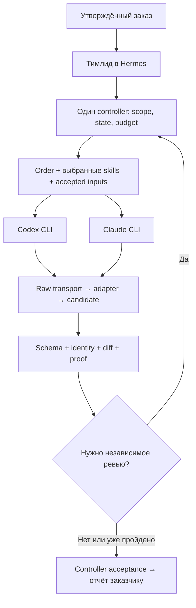

# CENTURION 3.0 — взаимодействие исполнителей и туннель CLI

Дата: 2026-10-16. Ветка: `feat/centurioncli/v3-autonomous-team`, baseline `e89ff3f`. Это аудит и решение для [единого плана](CENTURION_3_0_IMPLEMENTATION_PLAN.md), не реализация нового runtime.

## 1. Решение

**Сохранить строгий машинный контракт, унифицировать адаптеры и отделить ошибку отчёта от ошибки работы.** Главная ценность прежнего подхода сохранилась: исполнитель получает ограниченное поручение, контроллер получает проверяемый результат. Современные модели и native structured outputs снижают вероятность неправильной формы, но не заменяют приёмку.

Для первой 3.0 выбрать **Hermes как среду тимлида + существующий controller/Gateway + процессы Codex CLI и Claude CLI**. Локальный туннель — stdin/файлы и stdout/stderr; отдельный сервер, порт, брокер, agent-chat или новая БД не нужны. Hermes здесь не обязательный третий worker: его CLI JSONL полезен при автоматизированном запуске самого тимлида. Добавление Hermes-child в product dispatch не является условием выпуска.



Обратная стрелка означает только назначенное контроллером ревью по V1–V3. Reviewer не запускает reviewer; V0 проходит без него. Исполнители не назначают друг другу работу: им передаются адресные поручения и проверенные артефакты через одного владельца.

## 2. Как устроено сейчас

| Механизм | Подтверждённое поведение | Решение |
| --- | --- | --- |
| [LEGION_CONTRACTS](LEGION_CONTRACTS.md) и [shared contracts](../integrations/legion-contracts/lib/contracts.mjs) | `LEGION_ORDER_V1` и Hermes `AGENT_ORDER_JSON_V1` валидируются разными entrypoints; legacy `LEGION_RESULT_V1` отличается от canonical result | Один active order для 3.0; legacy read-only compatibility, без автоматического запуска старого заказа |
| [runner](../integrations/hermes-legion-kit/skills/autonomous-ai-agents/agent-contract-runner/scripts/agent_contract_runner.py) | `AGENT_ORDER_JSON_V1`, обязательные scope/proof/output поля, controller `Aquila`, routing и loop state | Использовать существующий runner/state, не строить второй |
| [result schema](../integrations/hermes-legion-kit/skills/autonomous-ai-agents/agent-contract-runner/references/agent-result.schema.json) и [builder](../integrations/hermes-legion-kit/skills/autonomous-ai-agents/agent-contract-runner/scripts/agent_result_builder.py) | Общий `AGENT_RESULT_JSON_V1`; required arrays; `filesChanged` — объекты; `done` требует proof/self-review; create-only finalization | Сохранить семантику, устранить дрейф копий и adapter mismatch |
| [response envelope](../integrations/hermes-legion-kit/skills/autonomous-ai-agents/agent-contract-runner/scripts/response_envelope.py) | Raw JSON или один чистый lowercase `json` fence; сохраняются точные raw/normalized bytes; identity/handoff/hash проверяются | Сохранить. Не извлекать JSON из произвольной прозы |
| [Gateway](../integrations/hermes-legion-kit/skills/autonomous-ai-agents/agent-contract-runner/scripts/result_gateway.py) | Запускает Codex/Claude, сохраняет start/closure, proof и acceptance; raw/candidate/result различаются; не повторяет side effect из-за missing result | Сделать единым launch/acceptance путём новых product orders; direct path не должен иметь другую политику |
| [accepted inputs](../integrations/hermes-legion-kit/skills/autonomous-ai-agents/agent-contract-runner/scripts/accepted_inputs.py) и [lineage](../integrations/hermes-legion-kit/skills/autonomous-ai-agents/agent-contract-runner/scripts/artifact_lineage.py) | Проверяют принятые входы и product-file hashes; same-UID authorship не гарантируется | Переиспользовать по нужной зависимости, не превращать все сообщения в новую trust platform |
| [Claude order skill](../integrations/claude-legion-kit/plugin/skills/claude-order/SKILL.md) и guard | Инструкция называется `CLAUDE_ORDER v1`, результат уже canonical; legacy result включается явно | Одинаковые active instructions для всех исполнителей; guard остаётся техническим адаптером |

Исторические a10–a12 и bytecode-сбой уже проверены в §2 плана: содержательно готовая работа отвергалась из-за control artifacts/путей. При этом текущий Gateway сам не делает автоматический product replay — опасность возникает, когда следующий управляющий шаг трактует любой `failed` как необходимость снова реализовать задачу.

## 3. Актуальные клиенты и источники

Проверены локальные версии/help, исходники установленного Hermes и открытые официальные страницы. Published release и установленный binary — разные факты.

| Клиент | Локально 2026-10-16 | Опубликованная версия на дату проверки | Полезный интерфейс |
| --- | --- | --- | --- |
| Codex CLI | `0.163.0` | `rust-v0.163.0` | `exec --json --output-schema FILE --output-last-message FILE`; stdin prompt через `-` |
| Claude Code | `2.1.224` | `v2.1.301` | `-p --output-format json` / `stream-json`, `--json-schema`, `--effort`; schema-результат находится в `structured_output` |
| Hermes | checkout tag `v0.22.2`, commit `d923a5eb487a17c0a68801bba9ef0f56c81040a8` | `v0.22.2` | `chat --oneshot --query-file PATH --format stream-json`; terminal `result` содержит `text`, `session_id`, `exit_code` |

Источники:

1. [OpenAI: non-interactive mode](https://developers.openai.com/codex/noninteractive) — JSONL events отдельно от final response, `--output-schema`, `-o`, resume; `--full-auto` больше не поддерживается. Страница открыта и получена также как Markdown с redirect на `learn.chatgpt.com`.
2. [OpenAI: app-server](https://developers.openai.com/codex/app-server) — двунаправленный JSON-RPC поверх stdio, `thread/start`, `turn/start`, `outputSchema`, `turn/completed`, `turn/interrupt`. WebSocket помечен experimental/unsupported.
3. [Claude Code: headless](https://code.claude.com/docs/en/headless) — `structured_output`, JSON/stream JSON, session handling, ограничения bare mode. Документация уже описывает изменения после локальной 2.1.224; её поведение нельзя переносить на установленный CLI без проверки.
4. [Hermes CLI reference](https://hermes-agent.nousresearch.com/docs/reference/cli-commands) — прочитан официальный [исходник reference](https://github.com/NousResearch/hermes-agent/blob/v0.22.2/website/docs/reference/cli-commands.md) и локальный counterpart. `.md` URL сайта дал 404, что не скрывается под видом прочтения страницы.
5. [Hermes delegation](https://hermes-agent.nousresearch.com/docs/user-guide/features/delegation), [версионный исходник](https://github.com/NousResearch/hermes-agent/blob/v0.22.2/website/docs/user-guide/features/delegation.md) — `output_schema`, одна correction turn, `schema_valid`, fresh child context.
6. [Hermes Codex runtime](https://hermes-agent.nousresearch.com/docs/user-guide/features/codex-app-server-runtime), локальная версия этого документа — существующий optional мост Hermes → Codex app-server; это смена agent loop, не готовая реализация нашего acceptance contract.

Release metadata проверены через GitHub `releases/latest` у владельцев OpenAI, Anthropic и NousResearch. Никаких обновлений клиентов не выполнено. Локальный Claude отстаёт; обновлять его автоматически при обычном dispatch нельзя. `--bare` полезен для сокращения autoload, но у локальной версии нельзя предполагать поздние ограничения background work, а режим требует отдельной проверки авторизации через данного поставщика. Работающий direct Messages API не доказывает рабочий Claude CLI.

## 4. Реестр проблем и решений

| ID | Доказательство и последствие | Решение / этап |
| --- | --- | --- |
| CT01 | Несколько order vocabularies, общий result и разные validators; runner:719 фиксирует `Aquila`, Claude skill:22 просит `CLAUDE_ORDER v1` | Active 3.0 использует `AGENT_ORDER_JSON_V1` → `AGENT_RESULT_JSON_V1`. `Aquila` пока technical controller id, display «тимлид»; переименование не ломает wire. Legacy не переводится автоматически. N1/N5 |
| CT02 | Gateway:808 читает только terminal `result` string. Offline fixture: тот же валидный canonical object в `structured_output` отвергнут с `Claude terminal result must be a non-empty JSON string` | Явный adapter native schema / legacy text. Если присутствуют две расходящиеся содержательные формы — reject ambiguity, не «выбрать удобную». N3 |
| CT03 | Runner:412 запрещает `--output-schema` у Astra advisory. Fixture воспроизводит `unsupported option` при штатном CLI flag | Разрешить точно проверенный flag/path без ослабления read-only/model/effort. Проверить schema subset у поставщика заранее. N2/N3 |
| CT04 | Hermes `tools/delegation_output_schema.py:58–106` вырезает JSON из прозы, использует обычный `json.loads`, при отсутствии jsonschema принимает parsed JSON без schema validation. Это слабее strict ingress CENTURION | `schema_valid=true` Hermes не является нашим pass. Единый strict parser/schema после native transport, fixtures на duplicate keys/prose/missing validator. Не менять upstream Hermes ради core. N3/N5 |
| CT05 | Hermes `delegate_tool_child_run.py:478–517` делает одну correction через тот же `child.run_conversation`, не снимая в этой функции write-tools; docs сохраняют `completed` при `schema_valid=false` | Не включать этот путь в product dispatch первой 3.0. Если позже нужен — доказать no-write correction и учёт запуска. Сейчас report recovery принадлежит controller; не повторять продукт. N3/N4 |
| CT06 | Builder при malformed candidate создаёт synthetic `failed` с `filesChanged=[]`; отсутствие изменений в этом synthetic result не доказывает отсутствие реального diff, а create-only resultPath уже занят | В новых 3.0 transport failure получает protocol receipt, canonical result — лишь валидный авторский payload. Один report retry может завершить исходный order без rewrite. Никакого product replay; старые finalized results не открываются заново. N3/N4 |
| CT07 | CLI JSONL, final JSON, progress и canonical result — разные формы. Hermes `system.init.model` берётся из конструктора emitter; requested model не равен доказанному upstream model | Pin transport/candidate source до launch; raw stream + extraction binding; runtime/model evidence с честной границей наблюдаемости. Exit/terminal согласованы, но не заменяют acceptance. N3/N6 |
| CT08 | Текущий `responseEnvelope` допускает лишь exact raw JSON/fence normalization; semantic metadata rewrite нарушит candidate-to-result binding (runner:610–663) | Known controller fields создаются вне авторского payload. Не исправлять orderId/executor/status/proof или типы arrays эвристически. Для native wrapper сохранять wrapper и точное извлечение в closure/evidence, далее существующий envelope. N3 |
| CT09 | Claude skill:26 рекомендует `permission-mode default`, отсутствующий в локальном help; документация bare и установленная версия расходятся | Capability preflight и versioned fixtures для поддержанного CLI. Permissions выбираются из уже выданных полномочий; нет blanket bypass ради отсутствия вопросов. N5/N6 |
| CT10 | Gateway сейчас запрещает одновременные lineage и Loop V1 (`result_gateway.py:1085`); оба упомянуты как основа нового цикла | Явно устранить несовместимость в N3/N4 либо оставить один выбранный способ snapshot/hash binding для данного handoff. Не обещать, что оба уже работают вместе. N3/N4 |
| CT11 | Canonical schema допускает extensions и `additionalProperties:true`; native providers поддерживают собственное подмножество JSON Schema | Один canonical source, минимальные воспроизводимые native projections по выбранному клиенту, fixture parity; не три вручную поддерживаемые схемы. Проверка до исполнения; validated file-candidate mode допустим без native schema. N1/N3/N6 |
| CT12 | «8 inference-запусков» двусмысленно: один CLI agent run содержит много model API/tool turns, native schema retry может скрыть дополнительную работу | Явно считать controller launches и correction turns; отдельно API calls/tokens по доступной telemetry. Встроенные retry ограничиваются wall-time/доступными client limits. Не заявлять cap фактических API calls без enforcement. N1/N4/N7 |

## 5. Точный контракт для новой версии

Одинаковая форма означает один фиксированный тип **поручения** и один фиксированный тип **ответа**, а не одинаковые поля у запроса и результата. JSON с полными authority/scopes генерирует controller, модель пишет содержательную часть отчёта. Пользователю остаётся обычный понятный итоговый текст.

| Данные | Где уже живут / кто владеет |
| --- | --- |
| Версия order, orderId, controller, executor, role | `AGENT_ORDER_JSON_V1`; technical controller `Aquila`, функциональная роль в `roleForTask` |
| Цель, non-goals, scope, критерии, proof, stop conditions | Существующие required поля order; передаются полностью для этого slice, без надежды на память другой CLI-сессии |
| Mission/task/attempt, policy и полномочия | Один controller state + существующие `context`/`notesForExecutor` binding. `routing.objectiveId` и `attempt` уже есть; N1 фиксирует отображение, не добавляет параллельный обязательный `attemptId` в V1 result |
| Маршрут | Существующий routing + ExecutionDecision, точные model/effort; результат автора не меняет route |
| Output | `outputContract.resultVersion`, `resultPath`, `stdoutAllowed`, `proseAllowedAfterJson`, transports и exact handoff; не новое поле `schemaId` вместо `resultVersion` |
| Result | `AGENT_RESULT_JSON_V1`: orderId/executor/status/summary/filesChanged/artifacts/proof/selfReview/scopeDeviations/forbiddenPatternHits/remainingRisks/questions/errors/stdoutSummary/stderrSummary; handoff echo |
| Acceptance | Controller receipts/proof/diff/review binding; `done` означает claim исполнителя, не итоговую приёмку |

Существующий `inputResults` имеет `orderId`, result path/hash, acceptance path/hash, closure path и selected artifacts с path/hash/mediaType. Start/closure/order chain проверяется из этих файлов; не придумывать отсутствующие wire-поля. Downstream исполнитель видит проверенные входы и свою цель; чужие артефакты — данные, не новые полномочия.

Reviewer использует тот же result envelope, а **`executorExtensions.review`** обязателен для 3.0 review order и native review projection: `verdict` (`pass|fail|blocked`), `findings` (array), `reviewedOrderId`, `reviewedResultSha256`, `productSnapshotSha256`. Контроллер сравнивает binding со своим snapshot. `status=done` означает «ревью выполнено» и совместим с verdict `fail`; missing verdict не даёт pass и не запускает product replay. Реальный failed proof не переименовывается в pass ради `done`. Базовый V1 не требует review extension у обычного исполнителя. `LEGION_REVIEW_V1` остаётся legacy/advisory формой, не вторым active ответом.

## 6. Практический транспорт

**Основной путь:** один process invocation на ограниченный order, фиксированные argv/cwd/env, prompt через stdin/файл, отдельные stream/result paths. Shell interpolation текста поручения запрещена; `shlex.split` существующего command недостаточно для безопасного конструирования shell string. Миграция к argv или безопасный serializer решается в имеющемся launcher, не в новом framework.

- **Codex:** `exec --json --output-schema <projection> --output-last-message <candidate> -`, явные model/effort и допустимый sandbox. `--json` — events; `-o` — candidate. Candidate presence до process closure не означает завершения. Если native schema не поддержана provider route, выбрать заранее проверенный file-candidate mode до product launch. Не повторять выполненную работу ради добавления schema flag.
- **Claude:** `-p --output-format json --json-schema <projection>` с явными model/effort/tool permissions. Prompt — stdin, schema — argv value без shell. Candidate берётся из `structured_output`; для явно выбранного text mode — из terminal `result`. Проверяются session/model metadata, terminal subtype/is_error/permission denials, процесс и product scope. Stream mode нужен только при необходимости progress/tool evidence; versioned adapter учитывает разрешённые служебные events и не склеивает текст всех assistant messages. `--bare` включается лишь после capability/auth/tool probe в изолированной конфигурации; отдельного требования менять credentials нет.
- **Hermes:** controller использует нынешний native loop; при необходимости внешнего наблюдения `chat --oneshot --query-file <prompt> --format stream-json`. `system.init`, terminal `result` и exit/session связываются, `result.text` остаётся текстом до strict validation. `tool_result.output` обрезается до 5000 chars и не заменяет полный proof artifact. Этот CLI protocol не добавляет Hermes-worker/model в active routing.

Native wrapper сохраняется целиком; adapter фиксирует выбранный field/event, свой version и hashes wrapper/candidate в имеющейся closure/evidence. Повторный разбор неизменного evidence возвращает тот же candidate. Если два источника выбраны одновременно и расходятся — protocol error. Готовый `AGENT_RESULT_JSON_V1` не перезаписывается адаптером, даже ради исправления «очевидного» поля.

Передача heartbeat/progress не является приёмкой и не требует LLM. Нет обязательного ACK round-trip от модели перед работой. Controller сам выполняет preflight, сохраняет start receipt, наблюдает process/event stream, затем принимает результат.

### Почему сейчас не app-server / MCP / ACP

| Подход | Оценка |
| --- | --- |
| Процессы + файлы/stdin | Рекомендован для первой 3.0: уже есть Gateway/custody/recovery, естественно ограничивает один slice, минимум новых lifecycle rules |
| Codex app-server stdio | Полезен для настоящего интерактивного steer/cancel/resume без relaunch. У Hermes 0.22.2 мост уже есть, писать второй не надо. Но включение меняет agent loop, tools/MCP projections и config, не создаёт наши acceptance receipts автоматически; пока optional после отдельного доказательства необходимости |
| Hermes `delegate_task` | Встроенные subagents и одна schema correction полезны, но toolful retry/permissive parsing и отдельная hierarchy несовместимы с новой policy без адаптации. Не core launch path |
| MCP / ACP / Hermes serve / kanban | MCP передаёт tools, ACP обслуживает editor sessions; они не заменяют order/result/acceptance. Новый daemon/queue/board создаст второй lifecycle; вне первой версии |
| Прямой pipe Codex → Claude / shared chat | Теряет явную authority, accepted-input binding и независимость reviewer; не использовать для product dispatch |

Смена транспорта позже не меняет контракт и не оправдывает второй controller. Resume возможен только по записанному session ID и состоянию процесса, не через `--last`/`--continue` в общей рабочей папке.

## 7. Восстановление без повторного исполнения

В существующей записи attempt различать transport outcome, executor claim и controller acceptance. Не вводить новый mission status ради каждого сбоя. Неизвестный эффект — причина recovery/blocked, а не автоматическое `failed -> launch`. Для новой policy 3.0 malformed transport не создаёт synthetic executor result: сохраняется protocol-failure receipt. Это явное изменение finalization/monitor capability, а не переписывание исторических V1 результатов или скрытое принятие старым runtime.

| Случай | Действие контроллера |
| --- | --- |
| Один чистый fence / native wrapper | Детерминированное извлечение, raw evidence неизменно, 0 model calls |
| Неправильный orderId/executor/handoff, противоречивые payloads | Отказ identity/ambiguity. Не подставлять ожидаемый ID и не присваивать чужой ответ |
| `remainingRisks` строкой, недостающий авторский вывод или отсутствующий отчёт | Сначала собрать уже существующие evidence и проверить процесс. Если нужно авторское дополнение — максимум один отдельный report-only вызов, без product-write/side-effect tools; иначе честная незавершённость |
| Не хватает proof | Только действительно разрешённая проверка; её результат пишет controller отдельно. Не сочинять proof в авторском JSON и не объявлять проверку без побочных эффектов автоматически |
| Потеря связи/timeout после возможной записи | Проверить живой process/session, receipts, product diff. Неизвестное действие не повторять. Продолжение/recovery лишь после установления его исхода |
| Валидный отчёт + доказанный дефект продукта | Новый bounded fix-order в общем бюджете, с точным нарушенным критерием; изменённое условие перепроверяется |
| Duplicate delivery / controller restart | Один task/product-attempt intent и lock; существующий accepted result возвращается повторно без запуска модели. Смена orderId не обнуляет task identity/budget |

Report-only вызов — отдельная transport attempt **того же logical order**, с новым controller attempt id и подкаталогом внутри исходного control namespace. Неизменный order/raw/proof/product snapshot и явный режим «только отчёт» передаются исходному executor/model с технически снятой возможностью менять продукт; первоначальная launch-команда не повторяется. Ответ сохраняет исходные orderId/handoff. Новый raw candidate, reporting start/closure и hashes связываются с исходным launch в acceptance. Canonical result по исходному resultPath создаётся ровно один раз после schema/identity/proof; раньше там нет fake failed. Авторский валидный failed остаётся failed. Ни сырой старый ответ, ни существующие results не редактируются.

Downstream `inputResults` продолжает ссылаться на **исходный** order/result/acceptance/closure. Его verifier дополнительно проверяет reporting receipt/candidate и неизменность product snapshot; второй канонический accepted result задачи не появляется. Ключ `(mission, task, productAttempt, reportOrdinal=1)` однократно резервируется controller: restart/duplicate собирает прежний отчёт, а не создаёт второй. Если report снова невалиден, state/closure фиксируют protocol failure без фиктивного executor result. N1/N3 должны версионировать эту receipt capability, чтобы старый monitor не интерпретировал её по прежним правилам.

«No-write» относится к продукту: модель возвращает ответ в канал, stdout/candidate/result записывает CLI/controller. Существующий Codex read-only sandbox с запрещённой сетью/эскалацией либо Claude с пустыми tools/MCP и проверенной конфигурацией без hooks/background writers — кандидаты для этого режима. `permission-mode` без проверки не гарантирует FS-изоляцию. Переиспользуются штатные ограничения и guard/diff, новый enforcement framework не создаётся. Одна harmless deny-проба выполняется перед первым реальным report-only запуском: может быть перенесена в N2/N3 из прежнего бюджета N7. Offline N3/N6 проверяют обе ветки; реальное no-write остаётся отдельным live proof, его провал не объявляется pass.

Единицы бюджета в новом mission state: `budget.modelLaunchesUsed`, `budget.deadlineAt`, `task.productAttemptsUsed`, `attempt.reportAttemptsUsed`. Запуск резервируется до spawn/request и не возвращается при auth/permission/provider error; один и тот же intent/restart не резервируется повторно. Status check не меняет launch counter, deadline продолжает действовать. Report attempt расходует общий launch и единственный report slot, product counter не увеличивается. API calls/tokens — отдельная telemetry, а не ложный cap числа requests. Native correction с доступными tools/неизвестным лимитом не включается как бесплатный recovery; выбирать проверенный file-candidate mode заранее.

Если нет технически подтверждённого no-write режима, report-only inference не запускается с прежними write permissions. После единственного неудачного дополнения — протокольный blocker/failed в пределах существующих состояний, без циклов «оформи ещё раз». Только фактический дефект требует новой реализации.

## 8. Проверки и перенос в план

В текущем аудите прошли существующие focused checks: envelope **5** pass groups, builder **19**, Gateway **45**, handoffs **12 tests**, shared contracts smoke **pass**. Gateway run — 115.6 seconds. Они используют fixtures/fake executors; не являются live proof трёх клиентов или 3.0.

Дополнительно offline вызовом текущих функций воспроизведено:

```text
Claude terminal.result = JSON string: accepted
Claude terminal.structured_output = same valid object: rejected
  Claude terminal result must be a non-empty JSON string
Astra advisory + --output-schema: rejected
  Astra advisory launch has an unsupported option: --output-schema
```

Логи: `/tmp/centurion-tunnel-proof-20261016/{envelope,builder,gateway,handoffs,contracts}.log`; reproductions — `reproductions.json`. Исходники не менялись; bytecode generation отключён. Ссылки/versions/source evidence входят в этот документ; временный cache не становится runtime dependency.

N1 фиксирует контракты, identity mapping и ownership полей; N2/N3 устраняют native schema и extraction mismatch; N3/N4 — format recovery, idempotency и Loop/lineage gap; N5 — единые instructions; N6 — versioned fixtures и capability manifest; N7 — реальный round-trip уже выбранных клиентов внутри прежних восьми проб и шести миссий. Новый Hermes-worker/app-server pilot не добавляется. Четыре новые группы A21–A24 находятся в едином плане; A05/A07/A09/A12/A14/A19 расширяются по найденным конкретным случаям.

Граница проверки: installed help/source ≠ provider support; native schema ≠ correctness; `model` из request/init ≠ доказанный upstream execution; same-UID hash integrity ≠ authorship. Полный CLI/provider/no-write/recovery proof остаётся N7. План остаётся единственным списком реализации; этот аудит — обоснование и traceability.
